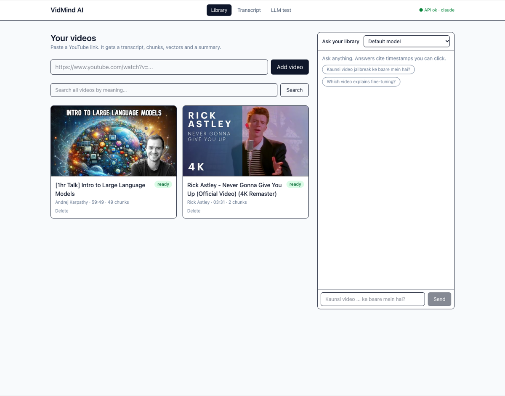
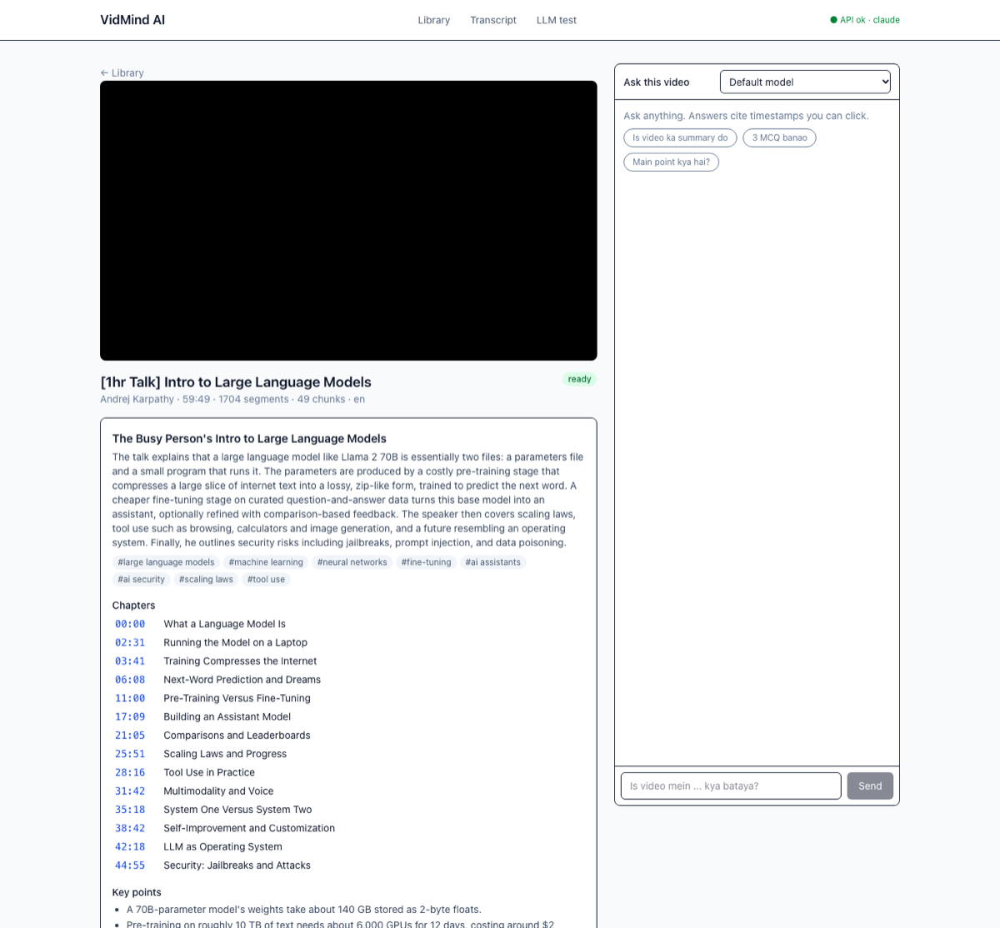

# VidMind AI

Chat with any YouTube video. Paste a link, then ask questions in English, Hindi or Hinglish and get answers with clickable `[mm:ss]` timestamps that jump the player to the exact moment.



## Why

Long videos (lectures, talks, tutorials) are hard to search. Generic "chat with YouTube" tools answer from the model's memory, give no timestamps and break on Hinglish. VidMind answers **only from the transcript**, cites the moment for every fact, checks those citations with a verifier, and measures its own accuracy with an eval.

## Features

- **Add a YouTube link** → captions, chunks, vectors and an auto summary are built in the background (status: `pending → processing → indexing → ready`)
- **RAG chat** with `[mm:ss]` citations that seek the player, streamed token by token (SSE)
- **Multi-agent graph** (LangGraph): router → retriever / library search / summarizer / quiz → answer → **citation verifier** with one retry
- **Query rewriting** for Hinglish questions (Hit@6 96% → 100% in the eval)
- **Auto insights**: title, summary, chapters, tags, key points (structured outputs)
- **Quiz mode**: MCQs with answers, explanations and timestamps
- **Library search** across all videos by meaning
- **OpenAI or Claude**: switch per message from the model dropdown, or set `LLM_PROVIDER`
- **MCP server** so Claude Desktop / Cursor can search and ask your videos
- **n8n**: Telegram message when a video is ready, and a YouTube channel watcher that auto-adds new uploads
- **Eval**: 28 questions with ground-truth time windows; hit rate @k, MRR and citation accuracy



## Architecture

```
 React + Vite ──REST + SSE──►  FastAPI  ◄── MCP server ◄── Claude Desktop / Cursor
                                  │   ▲
   n8n ◄── webhook (ready/failed) ┘   └── n8n channel watcher (POST /api/videos)
                                  │
     background job               │   chat
  captions → chunks (300 words,   │   LangGraph:
  50 overlap) → e5 embeddings     │   router ─┬─ qa ────────► retriever ──┐
  → ChromaDB → auto insights      │           ├─ search_library ► library ─┼► answer → verifier ─► END
                                  │           ├─ summary ─────► summarizer ─────────────► END   ▲ retry once
  SQLite: videos, segments,       │           └─ quiz ────────► quiz (MCQ) ─────────────► END
  insights                        │
                                  └── LLM provider layer: OpenAI | Claude
```

More detail in [docs/ARCHITECTURE.md](docs/ARCHITECTURE.md).

## Tech stack

| Layer | Tools |
|---|---|
| Backend | Python, FastAPI, Pydantic, SQLAlchemy + SQLite, BackgroundTasks, SSE |
| AI | Claude (`claude-haiku-5-5`) and OpenAI behind one provider interface, structured outputs, tool calling, LangGraph |
| Retrieval | `intfloat/multilingual-e5-small` (384 dims, local, Hindi + English), ChromaDB (cosine, HNSW) |
| Frontend | React 18, TypeScript, Vite, Tailwind, YouTube IFrame API |
| Integrations | MCP (`mcp` 2.x), n8n |
| DevOps | Docker Compose, nginx, GitHub Actions (ruff, pytest, build, docker build) |

## Eval results

28 questions on a 1 hour talk (22 English, 6 Hinglish), each with the time window that answers it. Full tables in [eval/README.md](eval/README.md).

| Chunk words | Hit@1 | Hit@3 | Hit@6 | MRR |
|---|---|---|---|---|
| 150 | 79% | 93% | 100% | 0.86 |
| **300 (default)** | **82%** | **96%** | 96% | **0.89** |
| 600 | 68% | 86% | 93% | 0.77 |

- Query rewriting by the router: Hit@6 **100%** (Hinglish 83% → 100%)
- Answers with Claude `claude-haiku-5-5`: **93-96%** cite the right moment, ~2.3 s per answer; when retrieval misses, the model says it did not find it instead of guessing
- Verifier catches made-up timestamps and asks for one retry

### OpenAI vs Claude

| | Claude (`claude-haiku-5-5`) | OpenAI (`gpt-4o-mini`) |
|---|---|---|
| Right citation (eval) | 93-96% | not measured yet |
| Avg answer latency | ~2.3 s | not measured yet |
| Structured outputs | `messages.parse` + Pydantic | `chat.completions.parse` + Pydantic |
| Sampling control | `output_config.effort` (no temperature on the current API) | `temperature` |

Run `python eval/run_eval.py --provider openai` with an `OPENAI_API_KEY` to fill in the OpenAI column.

## Quick start

### Docker

```bash
cp backend/.env.example backend/.env      # add ANTHROPIC_API_KEY or OPENAI_API_KEY
docker compose up --build                 # web on :8080, API on :8000
docker compose --profile automation up    # also starts n8n on :5678
```

The first question downloads the embedding model (~470 MB) into a volume.

### Local

```bash
cd backend
python3 -m venv .venv && source .venv/bin/activate
pip install torch --index-url https://download.pytorch.org/whl/cpu
pip install -r requirements.txt
cp .env.example .env                      # add your keys
uvicorn app.main:app --reload             # http://localhost:8000/docs

cd ../frontend
npm install && npm run dev                # http://localhost:5173
```

Tests: `cd backend && pytest -q` (130 tests, no API key or model download needed).

## API

| Method | Path | What |
|---|---|---|
| POST | `/api/videos` | Add a YouTube URL (202, background job) |
| GET | `/api/videos`, `/api/videos/{id}` | List / get videos with status |
| POST | `/api/videos/{id}/retry`, `/reindex` | Retry a failed video, rebuild vectors |
| GET | `/api/videos/{id}/transcript` | Paged transcript with keyword filter |
| GET/POST | `/api/videos/{id}/insights` | Title, summary, chapters, tags, key points |
| POST | `/api/chat` | Agent chat (intent, steps, citations, verified, quiz) |
| POST | `/api/chat/stream` | Same, as SSE: `start`, `step`, `token`, `retry`, `done` |
| POST | `/api/chat/rag`, `/api/chat/compare` | Plain RAG, and with vs without RAG |
| GET | `/api/search?q=&video_id=` | Semantic search across the library |
| | `/api/llm/*`, `/api/embeddings/*`, `/api/chunks/*` | Learning routes from days 1-5 |

Interactive docs at `/docs`.

## MCP and n8n

- **MCP**: `mcp_server/server.py` exposes `list_videos`, `search_videos`, `ask_video`, `get_video_summary`, `ingest_youtube`. Claude Desktop config in [mcp_server/README.md](mcp_server/README.md).
- **n8n**: import the two workflows from [n8n/](n8n/README.md) and set `N8N_WEBHOOK_URL`.

## Project structure

```
vidmind-ai/
├── backend/      FastAPI app: routers, ingestion, vectorstore, agents, llm, services, tests
├── frontend/     React + Vite app
├── mcp_server/   MCP server over the API
├── eval/         Questions, eval script, results
├── n8n/          Workflow exports
├── learn/        Daily practice scripts (day01 → day12)
└── docs/         Architecture, notes, tracker, changelog, plans
```

## Notes on YouTube

VidMind uses public captions through `youtube-transcript-api` and does not download video or audio. Videos without captions fail with a clear message.

## Docs

| File | What's inside |
|---|---|
| [ARCHITECTURE.md](docs/ARCHITECTURE.md) | System design and data flow |
| [NOTES.md](docs/NOTES.md) | What I learned each day, interview answers |
| [TRACKER.md](docs/TRACKER.md) | Day-by-day progress and eval runs |
| [UPDATES.md](docs/UPDATES.md) | Changelog |
| [RULES.md](docs/RULES.md) | Coding conventions and git rules |
| [COMMANDS.md](docs/COMMANDS.md) | Every command you need |
| [LEARNING_PLAN.md](docs/LEARNING_PLAN.md) | 14-day learning plan |

## Author

**Inderjeet Kumar** · [LinkedIn](https://linkedin.com/in/inderjeet-kmr) · [GitHub](https://github.com/inderlab)
